# Дека v2.0 — цифровой деканат на SvelteKit

> **Это прототип для конкурса.** Не является официальным сервисом университета.
> Все ФИО, группы, оценки, номера зачётных книжек и документы — вымышленные.
> Официальная символика вузов не используется: логотип «Дека» — собственный.

**Дека v2.0** — новый личный кабинет студента на **SvelteKit + PostgreSQL**, где вся учебная жизнь собрана в одном месте: расписание с переносами, оценки и сессия, заявки на справки со статусом-трекером, объявления деканата и ИИ-ассистент, который отвечает по личным данным студента. Полноценно работает на телефоне (от 360 px) и на десктопе.

## Скриншоты интерфейса

### Студент

| Обзор | Сейчас важно и уведомления | Расписание |
| --- | --- | --- |
| 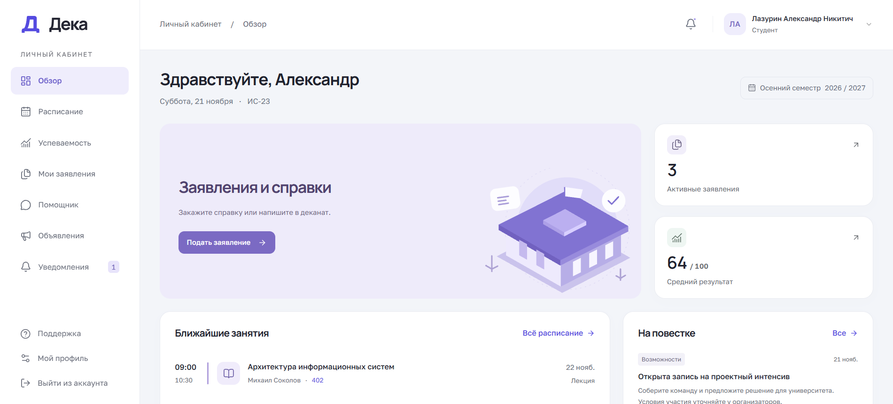 | 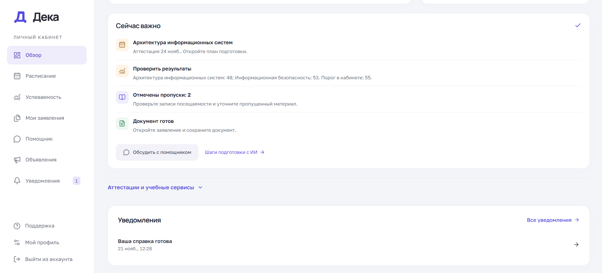 | 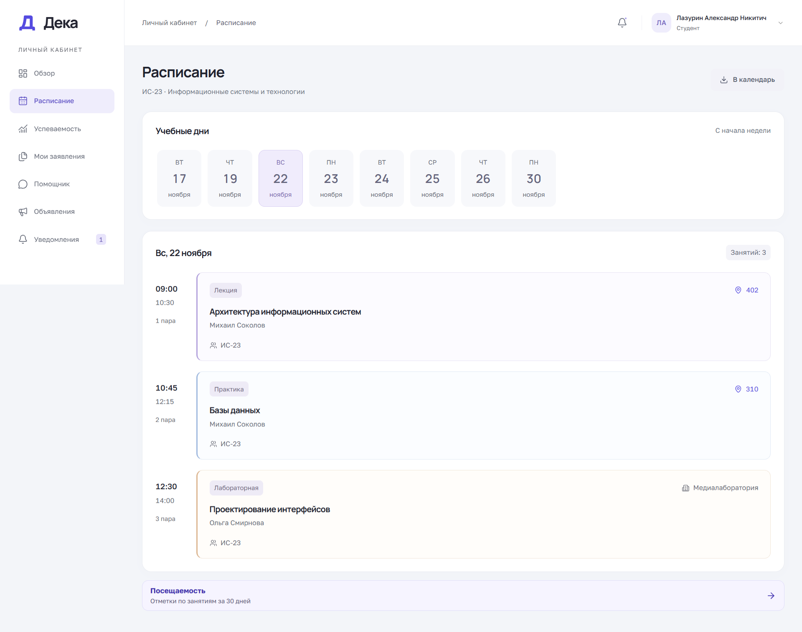 |

| Успеваемость | Студенческий билет | Помощник |
| --- | --- | --- |
| 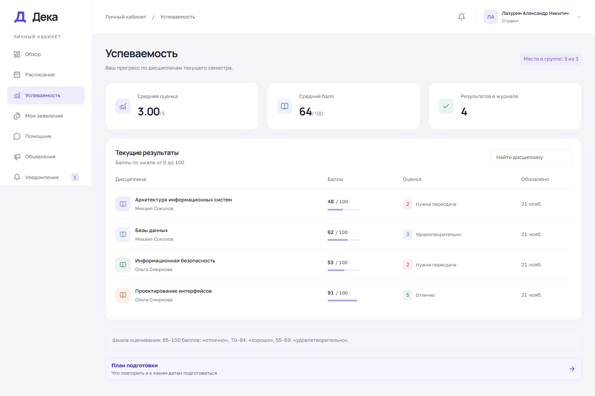 | 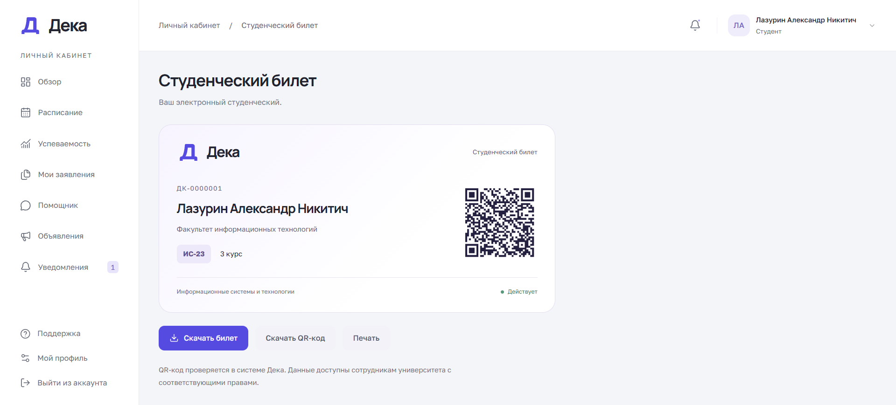 | 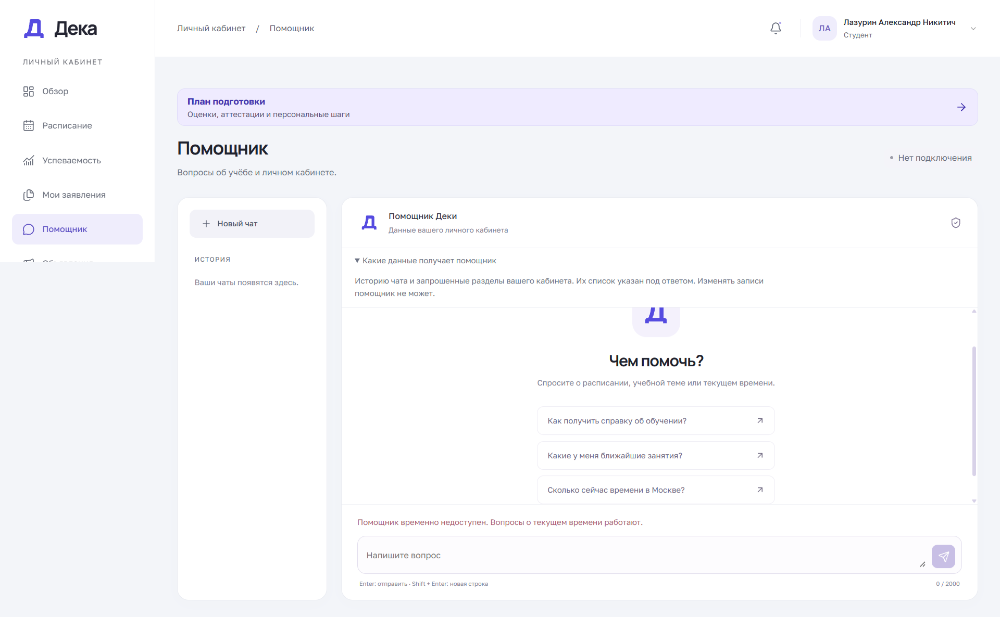 |

| Объявления | Профиль | Кампус |
| --- | --- | --- |
| 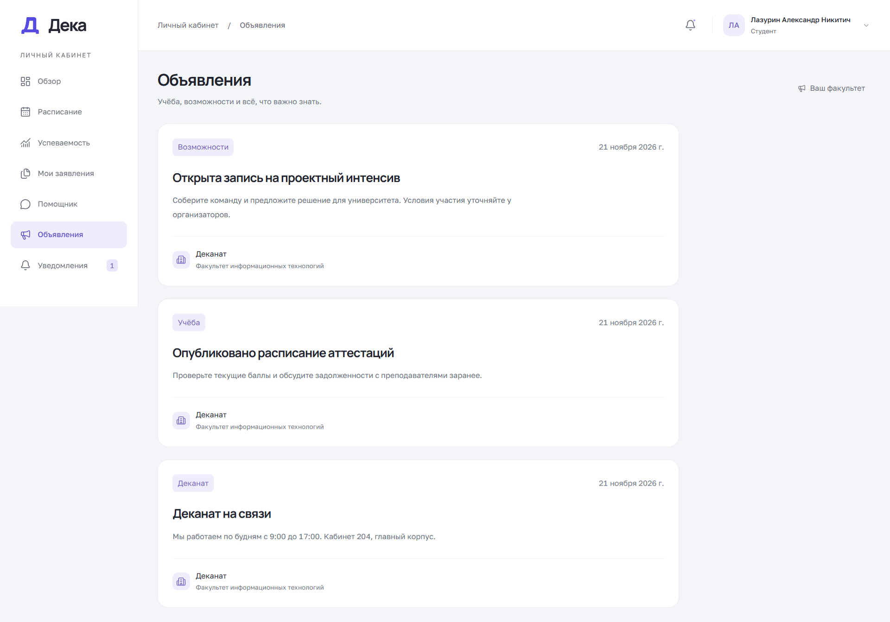 | 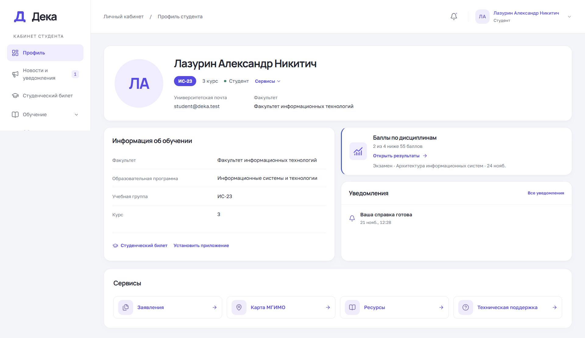 | 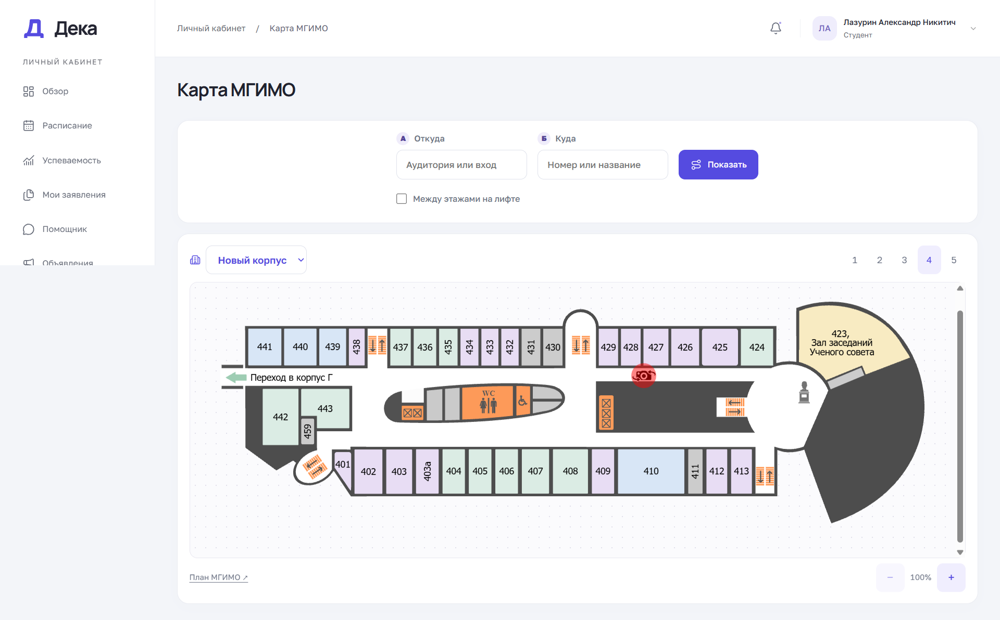 |

| Заявление в работе | Готово к выдаче | Готовый документ | Техническая поддержка |
| --- | --- | --- | --- |
| 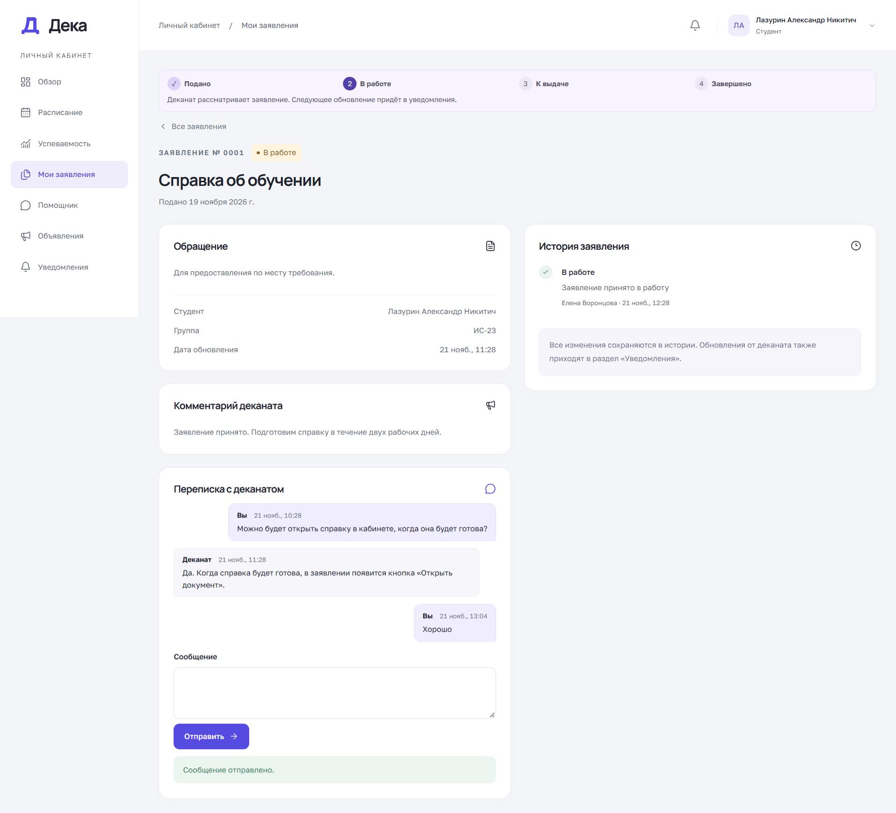 | 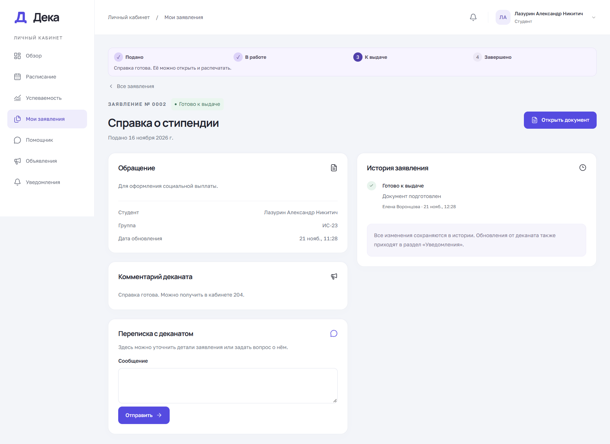 | 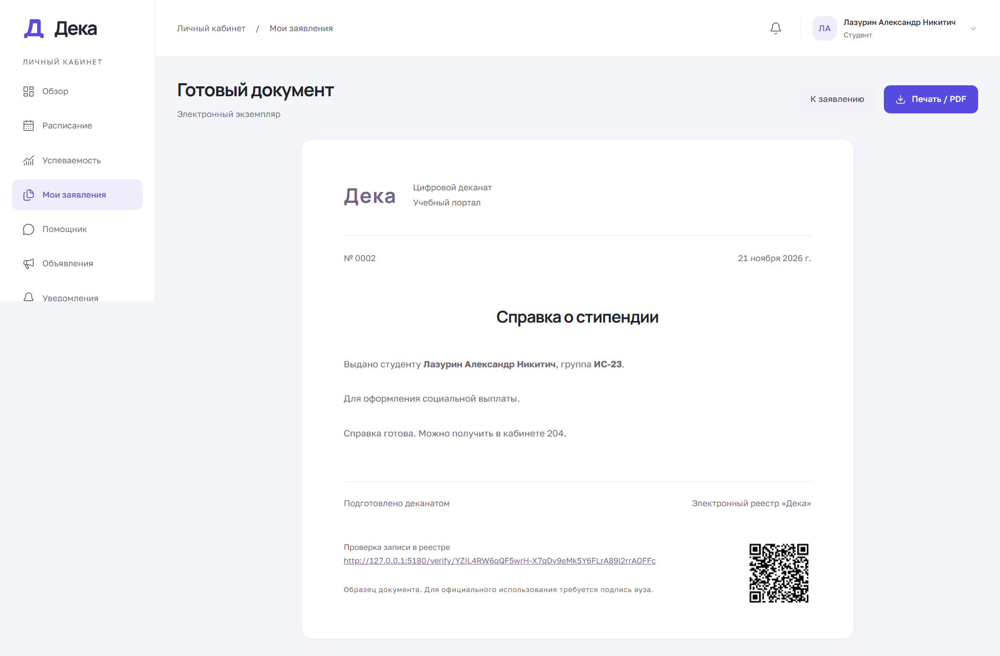 | 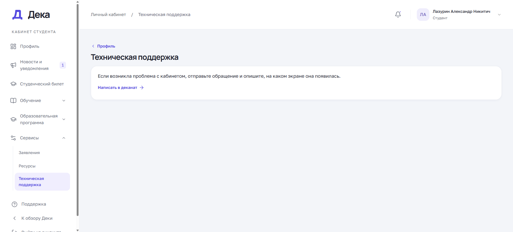 |

### Ассеты

| Логотип | Иконка 512 | Иконка 192 |
| --- | --- | --- |
|  |  |  |

---

## Что внутри

| Раздел | Студент | Сотрудник деканата |
| --- | --- | --- |
| Вход и профиль | логин/пароль, быстрый вход, ФИО, факультет, направление, курс, группа | вход, рабочий профиль |
| Расписание | сегодня + неделя, аудитории, преподаватели, переносы и отмены с подсветкой | создание переносов/отмен — студенты получают уведомления |
| Успеваемость | БРС: баллы по модулям, прогноз оценки, место в группе, расписание сессии | — |
| Заявки и справки | каталог типов, подача онлайн, статус-трекер «Подано → В работе → К выдаче → Завершено», QR-код выдачи, отмена своей заявки | очередь заявок, смена статуса, отклонение с причиной, генерация кода, папка «Отменённые» |
| Уведомления | статусы заявок, изменения расписания, дедлайны, объявления | публикация объявлений (всем или группе) |
| Проверка студенческого | QR-код на карточке ведёт на защищённую страницу проверки | ввод ссылки или кода, карточка студента, запись проверки в журнал |
| Импорт данных | — | CSV/XLSX: оценки и расписание, предпросмотр, ошибки по строкам, атомарное подтверждение |
| Журнал действий | — | заявки, расписание, импорт, проверки студенческих и объявления в одной ленте |
| Дополнительно | ИИ-ассистент «Дека» (чат по личным данным, голосовой ввод), электронный студенческий с QR (скачать PNG), учебный прогресс, карта кампуса с маршрутизацией | список студентов с поиском |

**Электронная справка и календарь.** Когда справка готова, студент открывает электронную версию — официальную печатную форму с номером, QR-кодом проверки подлинности и подписью декана — и сохраняет в PDF прямо из браузера. Расписание на 9 недель выгружается одной кнопкой в календарь (.ics): Google Calendar, Apple Calendar и Outlook подхватят файл с парами, аудиториями, преподавателями и напоминанием за 15 минут.

**Импорт учебных данных.** Деканат скачивает CSV-шаблон и загружает таблицу с оценками или расписанием (CSV/XLSX до 1 МБ и 200 строк). Сначала показывается предпросмотр: какие строки распознаны, какие логины/группы не найдены, где пересекаются преподаватель, аудитория или группа. Запись выполняется только после подтверждения, одной транзакцией; студенты получают уведомления, а факт импорта попадает в журнал действий.

**Проверка студенческого.** QR-код электронного студенческого содержит случайную ссылку без ФИО и номера зачётки. Сотрудник деканата открывает её после входа или вставляет ссылку в раздел «Проверка» — видит карточку студента, а проверка фиксируется в журнале. Студентам и гостям персональные данные по ссылке не показываются.

**Публичная проверка подлинности.** QR-код на справке ведёт на страницу `/verify` — её можно открыть без входа в систему (например, работодателю): номер документа и код проверки сверяются с базой, страница показывает реквизиты справки и срок действия. Неверный код честно возвращает «документ не найден».

**PWA и автономный режим.** В production-сборке приложение устанавливается на телефон как приложение (service worker + manifest, страница «Нет сети» для офлайна). Service worker никогда не кэширует API; вместо этого клиент хранит последний слепок данных в localStorage устройства — если сервер недоступен, разделы показывают сохранённые данные, а верхний баннер честно сообщает «Автономный режим» с временем слепка.

---

## Тестовые аккаунты (для жюри)

| Логин | Пароль | Кто это |
| --- | --- | --- |
| `student` | `demo1234` | Лазурин Александр Никитич, студент |
| `student2` | `demo1234` | Яров Егор Аркадьевич, студент |
| `student3` | `demo1234` | Северин Максим Львович, студент |
| `dean` | `demo1234` | Сотрудник деканата |
| `teacher` | `demo1234` | Преподаватель |
| `admin` | `demo1234` | Администратор |

Аккаунты создаются скриптом наполнения; пароли хранятся только в виде bcrypt-хеша. В демо-режиме доступен быстрый вход на экране авторизации.

---

## Как запустить локально

### Windows без Docker (PowerShell 7, Node 26.13+, PostgreSQL 18)

```powershell
.\deka.ps1 setup
.\deka.ps1 migrate
.\deka.ps1 seed
.\deka.ps1 start -WithoutAssistant
```

Откройте [127.0.0.1:5180](http://127.0.0.1:5180).

### Docker на Windows

```powershell
.\deka.ps1 docker-demo -WithoutAssistant
```

Откройте [localhost:5180](http://localhost:5180).

---

## Модули

| Модуль | Назначение |
| --- | --- |
| `auth` | Пароли, серверные сессии, роли, локальный быстрый вход |
| `student-cards` | Выпуск, QR, проверка и экспорт студенческого |
| `academics` | Расписание, результаты, рейтинг, ICS, ручной ввод и импорт |
| `requests` | Заявления, переходы статусов, история, документы, проверка |
| `announcements` | Публикация объявлений факультета |
| `notifications` | Уведомления конкретного пользователя |
| `administration` | Просмотр учётных записей, реестр студентов и аудит |
| `overview` | Сводка из других модулей |
| `assistant` | Чаты, доступный контекст, модель и системные часы |
| `study-plan` | Аттестации, приоритеты подготовки и отметки готовности |
| `campus` | Поэтажная схема, сопоставление аудиторий и маршруты по графу |

---

## Архитектура

Модульный монолит на SvelteKit. Один сервер приложения и одна PostgreSQL. Модель запускается отдельным процессом или контейнером.

### Папки проекта

| Путь | Ответственность |
| --- | --- |
| `apps/portal/src/routes` | Адреса, загрузка данных, HTTP-обработчики |
| `apps/portal/src/lib/application` | Оболочка, меню, стили, обновление приложения |
| `apps/portal/src/lib/modules` | Прикладные модули |
| `apps/portal/src/lib/shared` | Независимые компоненты, форматирование, валидация |
| `apps/portal/src/lib/server` | PostgreSQL и криптография |
| `apps/portal/src/service-worker` | Кеш только статических ресурсов, отдельная проверка типов |
| `apps/portal/static` | Шрифты, SVG, значки, manifest, offline-страница |
| `apps/portal/tests` | Проверки правил и сквозных сценариев |
| `apps/portal/tooling` | Миграции, начальное наполнение, тестовый запуск, настройки Compose |
| `database/migrations` | Применяемые по порядку SQL-миграции |
| `infrastructure/docker` | Dockerfile, Compose, роли БД, healthcheck |
| `infrastructure/windows` | Подготовка, запуск, остановка, резервное копирование |
| `infrastructure/assistant` | Закреплённая модель, скачивание с проверкой и продолжением загрузки |
| `infrastructure/release` | Единый архив исходников и реестр SHA-256 |
| `var` | Данные конкретной установки, не исходный код |

Внутри `var`: `config`, `postgres`, `models`, `runtime`, `logs`, `run`, `backups`, `reports`, `releases`, `history`. Внутри приложения `.svelte-kit` содержит служебный результат SvelteKit, `.output` серверную сборку, `.test-build` отдельную тестовую сборку, `node_modules` установленные зависимости. Все они игнорируются Git.

### Внутри модуля

`*.types.ts` описывает контракты; `*.labels.ts` подписи; `*.policy.ts` правила; `server/*.repository.server.ts` чтение; `server/*.service.server.ts` изменение данных; `ui/*.svelte` интерфейс. Все серверные файлы имеют суффикс `.server.ts`.

Маршрут проверяет роль, разбирает запрос и вызывает модуль. SQL в маршрутах запрещён. Общие компоненты не зависят от прикладных модулей.

Изменение заявления, история, аудит и уведомление сохраняются одной транзакцией. Учебные изменения сериализуются транзакционной блокировкой. Редактирование расписания проверяет версию записи и пересечения группы, преподавателя и аудитории. Подтверждение импорта повторно проверяет полномочия и либо записывает весь файл, либо откатывает изменения.

Оценка содержит версию; сохранение устаревшего значения отклоняется. История сохраняет предыдущий и новый балл вместе с автором и источником изменения.

Переписка хранится отдельно от смены статусов. Права повторно проверяются при чтении и записи. Сообщение и уведомления создаются в одной транзакции.

QR студенческого содержит случайную ссылку, без ФИО и учебных данных. Проверяющий должен войти в систему. Для преподавателя дополнительно проверяется закрепление группы, для деканата факультет. Заблокированная учётная запись не проходит проверку.

Модель не исполняет команды, SQL или сетевые запросы из текста ответа. Общие учебные вопросы разрешены. Вопросы о текущем времени обрабатываются серверными часами до обращения к модели.

---

## Локальный ИИ-помощник

MiniCPM5-2B в Q4_K_M и llama.cpp. Размер файла 1 561 318 368 байт. Ревизия, размер и SHA-256 закреплены в `infrastructure/assistant/model-manifest.json`.

### Docker

```powershell
.\deka.ps1 docker-demo
```

Модель включена по умолчанию. Сервис `model-init` загружает файл в `var/models`. Загрузка продолжается после обрыва, а готовый файл принимается только при совпадении размера и SHA-256. При повторном запуске проверенная модель используется без скачивания. Ошибка контрольной суммы блокирует запуск модели.

На Windows NVIDIA в Docker требует WSL2 и подходящий драйвер. При недоступном GPU выполняется повторный запуск на CPU. Принудительно выбрать CPU можно параметром `-Acceleration cpu`, исключить помощника — `-WithoutAssistant`.

### Windows без Docker

```powershell
.\deka.ps1 assistant
.\deka.ps1 start
```

При первом запуске скачиваются модель и проверенные бинарные файлы llama.cpp. Для GPU используется Vulkan, для резерва — отдельная CPU-сборка. На этом компьютере проверен запуск на NVIDIA GeForce RTX 5080.

Модель доступна только на `127.0.0.1:5188`. Настройки приложения в `var/config/application.env`:

```dotenv
AI_BASE_URL=http://127.0.0.1:5188/v1
AI_MODEL=deka-assistant
```

### Поведение

История хранится отдельно для каждого пользователя. Ответ поступает через SSE. Можно остановить генерацию и продолжить разговор позже. Сервер проверяет владельца чата, размер сообщения, Origin, частоту запросов и параллельные генерации.

Сервер выбирает разделы по вопросу: собственные оценки, заявления, посещаемость и готовность к аттестациям, расписание доступной группы, объявления факультета. Уточняющий вопрос может использовать тему предыдущих сообщений. Новый общий вопрос не вызывает загрузку личных записей. Количество записей и длина контекста ограничены; признак `hasMore` сообщает о сокращении.

Для учебных вопросов о JOIN и const добавлены краткие справочные сведения из официальной документации PostgreSQL и MDN. Это небольшой справочник, а не поиск по университетским документам. Преподавателю передаётся доступное расписание. Сотрудникам не передаются списки чужих оценок. Пароли, сессии и параметры подключения в контекст не входят. Модель не имеет инструментов для изменения данных.

Обычные вопросы об учёбе, программировании, планировании и повседневной жизни разрешены. Поддерживаемые вопросы о текущем времени обрабатываются серверными часами до обращения к модели. Интернет-поиск не подключён; актуальные погода, новости и цены модели недоступны.

Прямой вопрос о ближайших занятиях или экзамене, готовых справках и пропусках получает ответ из записей текущего студента. В ответе есть ссылка на раздел источника.

### Результат проверки

На настоящей модели выполнены 30 вопросов через приложение: личные записи, отсутствие сведений, учебные темы, время и границы доступа. Транспортных ошибок не было. При чтении ответов обнаружены ошибочное объяснение `const` и вымышленные задания в плане подготовки. MiniCPM 2B не прошла проверку качества для самостоятельных рекомендаций в реальном вузе.

На RTX 5080 короткие ответы достигали примерно 241–247 токенов/с, CPU с шестью потоками — около 40 токенов/с.

Для следующего сравнения выбрана официальная Qwen3-8B Q4_K_M.

---

## Карта кампуса

В кабинете доступны 31 векторный план корпусов А, Б, В, Г, Нового корпуса, библиотеки и столовой. Снимок опубликованных планов подготовлен 18 ноября 2026 года. Геометрия и подписи помещений взяты с сайта МГИМО. На каждом плане есть ссылка на страницу соответствующего этажа.

### Поиск и маршрут

В поле «Куда» можно ввести номер аудитории. Если нужен маршрут, укажите и начальную точку. Для проверки удобно выбрать 308 и 402 Нового корпуса. На официальной схеме 310, 311 и 312 подписаны вместе, а 310а обозначена отдельно. Кнопка «От главного входа» использует точку, подписанную университетом «Главный вход», на плане второго этажа корпуса В.

Планировщик выбирает путь с наименьшим числом смен планов в собранном графе. Он учитывает поэтажные лестницы, лифты и переходы между корпусами. В режиме «Между этажами на лифте» лестничные связи исключаются. Это пожелание к смене этажей. Для оценки доступности всего пути потребуются данные о порогах, дверях и действующих ограничениях.

Цветная линия внутри Нового корпуса проведена по видимым коридорам третьего и четвёртого этажей для размеченных аудиторий. На остальных участках интерфейс отмечает точки и показывает последовательность планов. Расстояние и время не измерялись. Закрытый служебный переход в библиотеку исключён.

### Данные

- Очищенная векторная графика в `apps/portal/static/campus/mgimo`. Файлы загружаются с сервера Деки по одному при открытии этажа.
- `apps/portal/src/lib/modules/campus/atlas.json` — этажи, точки в процентах от исходного SVG и связи.
- `apps/portal/src/lib/modules/campus/room-index.json` — однозначно сопоставленные номера для ссылок из расписания.
- `apps/portal/src/lib/modules/campus/campus-corridors.ts` — осевые линии размеченных коридоров.

---

## Развёртывание

### Windows

Нужен PowerShell 7, Node.js 26.13 или совместимое исправление ветки 26, PostgreSQL 18. По умолчанию локальный PostgreSQL слушает порт 55438, приложение — порт 5180. Пути к бинарным файлам хранятся в `var/config/runtime.json`, параметры приложения в `var/config/application.env`.

```powershell
.\deka.ps1 setup
.\deka.ps1 migrate
.\deka.ps1 seed
.\deka.ps1 start -WithoutAssistant
```

`setup` устанавливает зависимости из lock-файла и создаёт отдельный кластер, случайный пароль и локальные настройки. Если данные или настройки уже существуют, подготовка прекращается без их перезаписи. `seed` предназначен только для пустой базы локального показа.

Если программы отсутствуют в `PATH`, укажите пути при подготовке. Для второй копии задайте свободные порты параметрами `-AppPort` и `-DatabasePort`.

```powershell
.\deka.ps1 setup -NodePath 'C:\Runtime\node\node.exe' -PostgresBin 'C:\Runtime\postgres\bin'
```

### Docker

Все файлы находятся в `infrastructure/docker`. Контекст сборки остаётся корнем проекта; специфичный `Dockerfile.dockerignore` исключает `var`, зависимости и сборки. Финальный образ содержит production-зависимости, `.output`, миграции, служебные сценарии БД и healthcheck. Пользователь контейнера `node`, файловая система только для чтения.

```powershell
.\deka.ps1 docker-config
.\deka.ps1 docker-up
```

Compose запускает PostgreSQL 18.7, затем миграции и приложение. Порты БД и модели не публикуются. Доступен только `127.0.0.1:5180`. Приложение использует роль `deka_app`, миграции — роль `deka_owner`. Пароли генерируются в `var/config/compose.env` и не перезаписываются автоматически.

Пустую отдельную базу для презентации можно наполнить явно:

```sh
docker compose --env-file var/config/compose.env -f infrastructure/docker/compose.yaml --profile sample-data run --rm seed
```

### Резервные копии

```powershell
.\deka.ps1 backup
```

Создаётся custom-дамп `var/backups/deka-ДАТА-ВРЕМЯ.dump`. Файл не перезаписывает предыдущие копии. Восстановление проверяйте через `pg_restore` в отдельную пустую БД.

Нативная установка: `.\deka.ps1 backup-check` создаёт копию и восстанавливает её в отдельную базу с проверкой контрольных записей. Для Docker: `.\deka.ps1 docker-backup`.

Архив исходников: `.\deka.ps1 package`. Файл появляется в `var/releases`; локальное состояние не включается.

---

## Безопасность

### Приложение и БД

- Серверные сессии используют случайные токены и хеши в БД. Проверяются активность пользователя и права.
- Пароли хешируются scrypt с отдельной солью.
- Персональные ответы не кешируются service worker.
- SQL параметризован, операции записи выполняются транзакционно.
- Учётные записи домена `deka.test` и их ранее выданные сессии принимаются только в локальном режиме показа.
- Оценки имеют версии и историю. Подтверждение импорта сверяет версии из предпросмотра и откатывает весь пакет при конфликте.

### ИИ

- Контекст формирует сервер под текущего пользователя и текущий вопрос. Список переданных разделов указан под ответом.
- Секреты и параметры подключения модели не передаются.
- Сетевой провайдер ограничен локальными адресами; перенаправления запрещены.
- Модель не получает инструменты SQL, записи и отправки данных.
- Формулировки о чужих личных записях и изменении данных обрабатываются до передачи модели.

---

## Структура проекта

```text
apps/portal/                    # SvelteKit-приложение
├── src/
│   ├── lib/
│   │   ├── application/        # Оболочка, меню, стили
│   │   ├── modules/            # Прикладные модули (auth, academics, requests...)
│   │   ├── server/             # PostgreSQL, криптография
│   │   └── shared/             # Независимые компоненты
│   ├── routes/                 # Маршруты, обработчики
│   └── service-worker/         # Кеш статических ресурсов
├── static/                     # Шрифты, SVG, manifest, offline
├── tests/                      # Модульные и интеграционные тесты
├── tooling/                    # Миграции, seed, тесты
│   └── database/
│       ├── migrate.mjs         # Применение SQL-миграций
│       └── seed.mjs            # Наполнение демо-данными
├── package.json
└── vite.config.ts
database/migrations/            # SQL-миграции (001–011)
infrastructure/
├── docker/                     # Dockerfile, Compose, GPU-конфигурации
├── windows/                    # Скрипты для Windows без Docker
├── assistant/                  # Модель и загрузка GGUF
└── release/                    # Упаковка исходников
var/                            # Локальные данные (не коммитится)
```

---

## Стек

- **SvelteKit 3 + TypeScript** — серверный рендеринг, клиентские переходы, строгая типизация
- **PostgreSQL 18** — реляционная база, транзакции, оптимистичная блокировка
- **llama.cpp + MiniCPM5-2B** — локальный ИИ-ассистент, Apache-2.0
- **Vite 8 + Rolldown** — сборка SSR и клиентского бандла
- **pg (node-postgres)** — драйвер PostgreSQL, параметризованные запросы
- **scrypt** — хеширование паролей
- **qrcode** — генерация QR-кодов студенческого и справок
- **csv-parse + read-excel-file** — импорт CSV/XLSX, предпросмотр, ошибки по строкам
- **Svelte 5 + runes** — реактивность `$state`, `$derived`, `$props`
- **PWA** — manifest, service worker, offline-страница

---

## Лицензия

[CC BY-SA 4.0](./LICENSE) — свободное использование с указанием авторства и распространением на тех же условиях. Все данные в демо-версии вымышленные.
