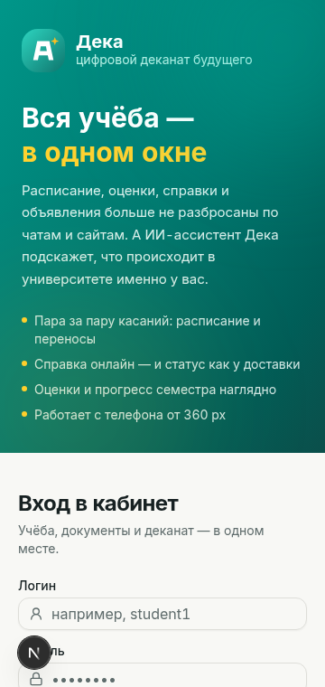
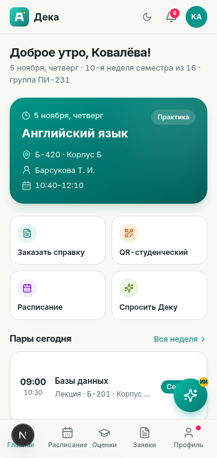
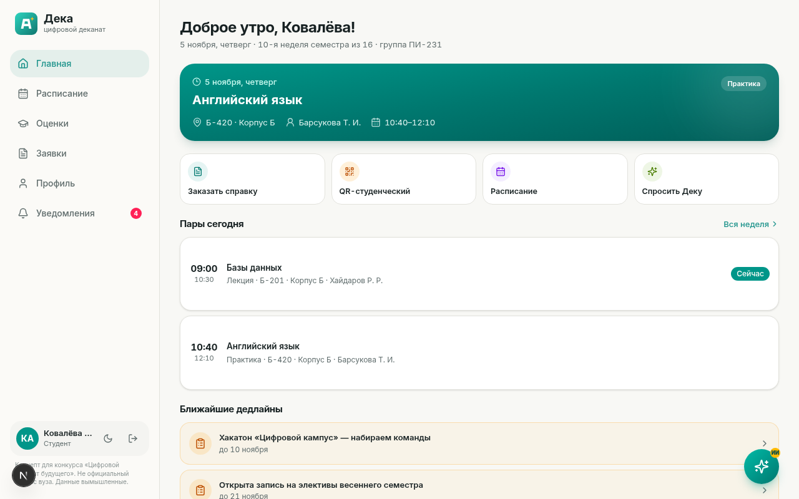
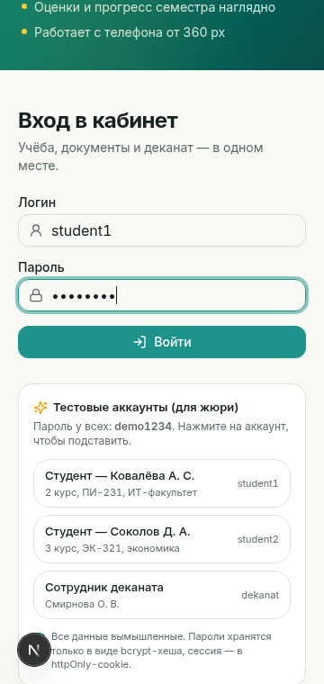
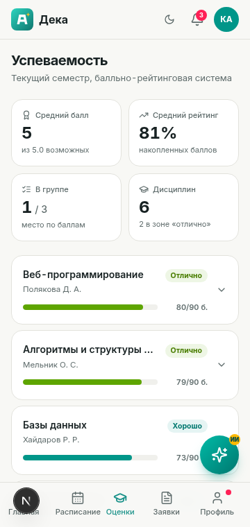
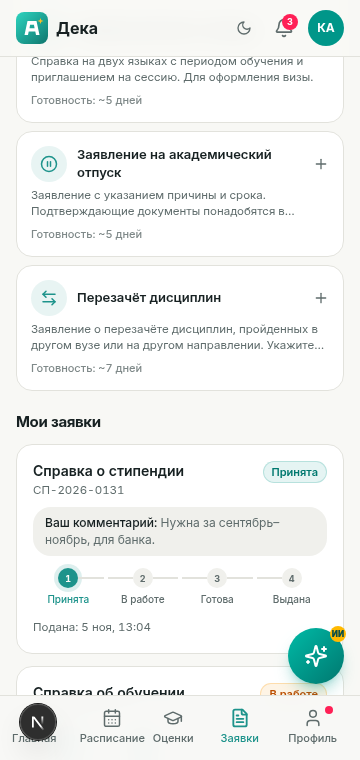
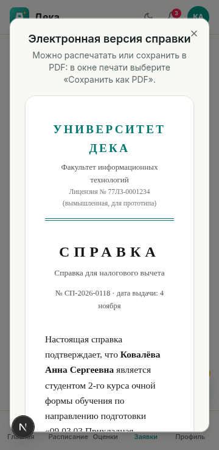
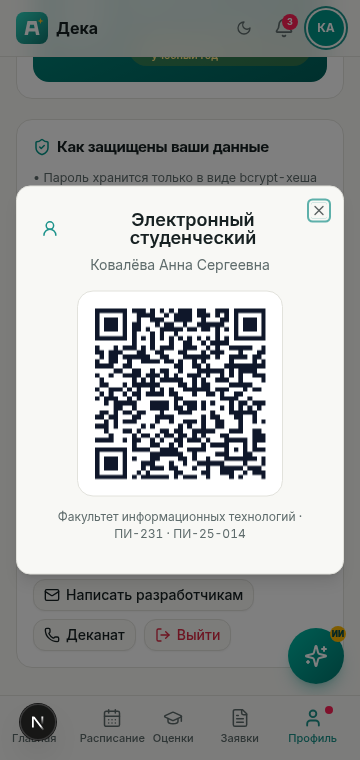
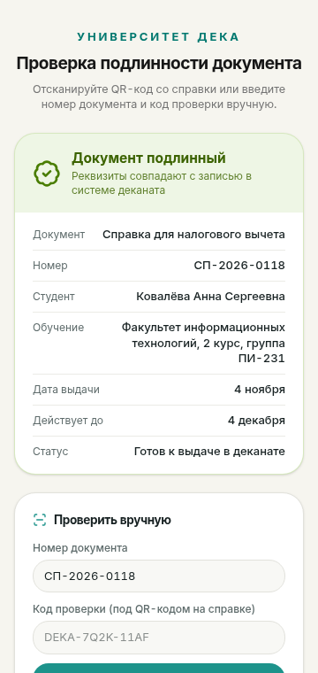

# Дека — цифровой деканат будущего (концепт для конкурса)

> **Это прототип для конкурса.** Не является официальным сервисом университета.
> Все ФИО, группы, оценки, номера зачётных книжек и документы — вымышленные.
> Официальная символика вузов не используется: логотип "Дека" — собственный.

**Дека** — личный кабинет студента, где вся учебная жизнь собрана в одном месте:
расписание с переносами, оценки и сессия, заявки на справки со статусом "как у доставки",
объявления деканата и ИИ-ассистент, который отвечает по вашим данным. Полноценно работает
с телефона (от 360 px) и на компьютере.

| Экран входа | Главный экран студента | Сотрудник деканата |
| --- | --- | --- |
|  |  |  |

| Расписание | Оценки (БРС) | Заявки на справки |
| --- | --- | --- |
|  |  |  |

| Электронная справка | QR студенческого | Проверка документа |
| --- | --- | --- |
|  |  |  |

Полный набор скриншотов (мобильный + десктоп, все разделы) — в [`docs/screenshots/`](docs/screenshots/).
Описание процесса создания, промпты и эволюция прототипа — в PDF: [`docs/deka-process-description.pdf`](docs/deka-process-description.pdf).

## Что внутри

| Раздел | Студент | Сотрудник деканата |
| --- | --- | --- |
| Вход и профиль | логин/пароль, ФИО, факультет, направление, курс, группа | вход, рабочий профиль |
| Расписание | сегодня + неделя, аудитории, преподаватели, переносы и отмены с подсветкой | создание переносов/отмен — студенты получают уведомления |
| Успеваемость | БРС: баллы по модулям, прогноз оценки, место в группе, расписание сессии | — |
| Заявки и справки | каталог из 6 типов, подача онлайн, статус-трекер "Принята → В работе → Готова → Выдана", QR-код выдачи, отмена своей заявки, пока она не готова | очередь заявок, смена статуса, отклонение с причиной, генерация кода документа, папка "Отменённые" |
| Уведомления | статусы заявок, изменения расписания, дедлайны, объявления | публикация объявлений (всем или группе) |
| Проверка студенческого | QR-код на карточке ведёт на защищённую страницу проверки | ввод ссылки или кода, карточка студента, запись проверки в журнал |
| Импорт данных | — | CSV/XLSX: оценки и расписание, предпросмотр, ошибки по строкам, атомарное подтверждение |
| Журнал действий | — | заявки, расписание, импорт, проверки студенческих и объявления в одной ленте |
| Дополнительно | ИИ-ассистент "Дека" (чат по личным данным, голосовой ввод), электронный студенческий с QR (можно скачать PNG), учебный прогресс | список студентов с поиском |

**Электронная справка и календарь.** Когда справка готова, студент открывает её электронную
версию — официальную печатную форму с номером, QR-кодом проверки подлинности и подписью декана —
и сохраняет в PDF прямо из браузера ("Печать → Сохранить как PDF"), не дожидаясь визита в деканат.
Расписание на 9 недель выгружается одной кнопкой в календарь (.ics): Google Calendar, Apple
Calendar и Outlook подхватят файл с парами, аудиториями, преподавателями и напоминанием за 15 минут.

**Импорт учебных данных.** Деканат скачивает CSV-шаблон и загружает таблицу с оценками или
расписанием (CSV/XLSX до 1 МБ и 200 строк). Сначала показывается предпросмотр: какие строки
распознаны, какие логины/группы не найдены, где пересекаются преподаватель, аудитория или группа.
Запись выполняется только после подтверждения, одной транзакцией; студенты получают уведомления,
а факт импорта попадает в журнал действий.

**Проверка студенческого.** QR-код электронного студенческого содержит случайную ссылку без ФИО
и номера зачётки. Сотрудник деканата открывает её после входа или вставляет ссылку в раздел
"Проверка" — видит карточку студента, а проверка фиксируется в журнале. Студентам и гостям
персональные данные по ссылке не показываются.

**Публичная проверка подлинности.** QR-код на справке ведёт на страницу `/verify` — её можно
открыть без входа в систему (например, работодателю): номер документа и код проверки сверяются
с базой, страница показывает реквизиты справки и срок действия. Неверный код честно возвращает
"документ не найден".

**PWA и автономный режим.** В production-сборке приложение устанавливается на телефон как приложение
(service worker + manifest, страница "Нет сети" для офлайна). Service worker никогда не кэширует API;
вместо этого клиент хранит последний слепок ваших данных в localStorage устройства: если сервер
недоступен, разделы показывают сохранённые данные, а верхний баннер честно сообщает "Автономный режим"
с временем слепка. Открытым страницам отправляются security-заголовки (X-Frame-Options, nosniff,
Referrer-Policy, Permissions-Policy), вход ограничен 10 попытками в минуту с одного IP.

## Тестовые аккаунты (для жюри)

| Логин | Пароль | Кто это |
| --- | --- | --- |
| `student1` | `demo1234` | Ковалёва А. С., 2 курс, группа ПИ-231, ИТ-факультет |
| `student2` | `demo1234` | Соколов Д. А., 3 курс, группа ЭК-321, экономика |
| `dekanat` | `demo1234` | Смирнова О. В., сотрудник деканата |

Аккаунты создаются скриптом наполнения; пароли хранятся только в виде bcrypt-хеша.

## Как запустить локально

Нужен либо **Bun 1.1+**, либо **Node 20+ с npm** — проект работает с обоими рантаймами.

Вариант с Bun:

```bash
git clone https://github.com/ВАШ_ЛОГИН/deka-dekanat.git
cd deka-dekanat
bun install
cp .env.example .env        # и подставьте свой AUTH_SECRET (openssl rand -hex 32)
bun run db:push             # создать базу SQLite (db/custom.db)
bun run db:seed             # наполнить вымышленными демо-данными (даты "от сегодня")
bun run dev                 # http://localhost:3000
```

Вариант с npm (чистый Node, без Bun):

```bash
npm install
cp .env.example .env
npm run db:push
npm run db:seed             # через tsx — работает без Bun
npm run dev
```

Продакшен-сборка: `npm run build && npm run start` (или `bun run build && bun run start`).
Деплой на сервер для жюри (Docker, VPS, Vercel) — см. [DEPLOY.md](./DEPLOY.md).

Демо-наполнение безопасно для данных: `db:seed` **не трогает непустую базу** — если
пользователи уже есть, скрипт сообщает об этом и выходит, ничего не удаляя. Чтобы
осознанно пересоздать демо-данные «от сегодня», запустите `npm run db:seed:force`
(или `tsx scripts/seed.ts --force`).

## Децентрализация и независимость

Прототип сознательно спроектирован так, чтобы работать **сам по себе** — без привязки
к инфраструктуре конкретного вендора, облака или среды разработки:

1. **Свои данные у студента.** В профиле кнопка "Мои данные (JSON)": все оценки, заявки,
   уведомления и расписание выгружаются одним файлом — данные принадлежат студенту,
   а не системе (data portability).
2. **База — локальный файл SQLite.** Не нужен отдельный сервер БД: скопировал папку —
   перенёс всё приложение. Путь миграции на PostgreSQL описан в DEPLOY.md.
3. **ИИ-ассистент без привязки к вендору.** Достаточно любого OpenAI-совместимого API:
   `LLM_API_KEY` + `LLM_BASE_URL` + `LLM_MODEL` — OpenAI, OpenRouter или собственная
   модель университета на Ollama/vLLM. Без ключа ассистент не "умирает", а переходит
   во встроенный офлайн-режим, отвечая по данным студента из базы. Готовый стек
   "приложение + локальная модель" поднимает `docker-compose.ollama.yml`: ни один
   запрос к ИИ не покидает сервер университета.
4. **Работает с npm и с Bun.** Все скрипты (`db:seed` через tsx, `start` через node)
   не требуют конкретного пакетного менеджера; CI гоняет сборку на обоих рантаймах.
5. **Офлайн-устойчивость клиента.** PWA: приложение открывается без сети; последний
   слепок данных хранится на устройстве студента — расписание, оценки и заявки видны
   даже при недоступном сервере (баннер "Автономный режим" с временем слепка);
   расписание на 9 недель экспортируется в .ics — календарь живёт у студента, а не на сервере.
6. **Docker-образ для любой машины.** `docker compose up` поднимает всё целиком
   на любом VPS в РФ без зарубежных SaaS-зависимостей.
7. **Автодеплой на свой сервер.** Шаблон `.github/workflows/deploy.yml.example`:
   переименовать, вписать SSH-секреты — и каждый push в main сам обновляет ваш VPS.
   Облако платформы не участвует: код, база и ключи остаются у владельца.
8. **Суверенитет данных деканата.** Весь институтский массив — один файл: сотрудник
   деканата скачивает полную копию базы одним JSON ("Полный бэкап") и так же легко
   восстанавливает её на любой другой машине ("Восстановить из файла", замена идёт
   в одной транзакции с проверкой целостности). Плюс файловые снапшоты `npm run db:snapshot`
   и публичный health-check `/api/health` для мониторинга. Перенос проекта на новый
   сервер — без потери данных, истории и паролей (см. DEPLOY.md).
9. **Установка одной командой и восстановление без приложения.** `bash install.sh`
   превращает чистый Ubuntu-VPS в работающий прототип: сам ставит Docker, генерирует
   `AUTH_SECRET`, запускает контейнер и ждёт health-check (`--with-ollama` — стек с
   локальной моделью). Если приложение не поднимается, база всё равно восстанавливается:
   `npm run db:restore -- файл-копии.json` — CLI-восстановление из командной строки со
   страховочным снапшотом и подтверждением REPLACE. А после пуша тега `v*` GitHub Actions
   (release.yml) собирает Docker-образ в GHCR и прикладывает zip/tar.gz к релизу —
   новый сервер разворачивается даже без клонирования репозитория.

## Публикация на GitHub

```bash
git init
git add .
git commit -m "Дека — цифровой деканат будущего"
git branch -M main
git remote add origin https://github.com/ВАШ_ЛОГИН/deka-dekanat.git
git push -u origin main
```

Секреты в репозиторий не попадут: `.env`, база `db/*.db` и ключ подписи
`db/auth-secret.txt` уже исключены через `.gitignore`. После пуша GitHub Actions
прогонит линт и production-сборку (см. `.github/workflows/ci.yml`) — зелёная галочка
подтверждает, что репозиторий рабочий.

## Стек и почему так

- **Next.js 16 (App Router) + TypeScript** — один фреймворк на фронтенд и API, серверный рендер первого экрана, зрелая безопасность (Server Components не отдают логику в браузер).
- **Prisma + SQLite** — типобезопасные запросы, нулевая настройка для прототипа, прозрачный путь миграции на PostgreSQL при росте (см. DEPLOY.md).
- **Tailwind CSS 4 + shadcn/ui** — доступные компоненты (ARIA, клавиатура), тёплая фирменная тема, тёмный режим.
- **JWT-сессии (jose) в httpOnly-cookie** — не нужно серверное хранилище сессий; cookie недоступна JavaScript в браузере.
- **bcryptjs** — хеширование паролей.
- **qrcode** — генерация QR студенческого и кодов выдачи документов локально в браузере.
- **csv-parse + read-excel-file** — импорт учебных данных из CSV/XLSX на сервере: без внешних сервисов, с ограничением размера и предпросмотром до записи.
- **ИИ-ассистент** — серверная цепочка провайдеров: любой OpenAI-совместимый API (`LLM_API_KEY`), платформенный SDK или встроенный офлайн-режим; ключи только в переменных окружения сервера.
- **Суверенитет данных** — полный бэкап/восстановление базы через кабинет деканата и из CLI (`db:restore`;
  JSON-формат `deka-backup`, общее ядро валидации в `src/lib/backup-core.ts`, транзакционная замена),
  файловые снапшоты SQLite, health-check `/api/health`.
- **Журнал аудита и защита от гонок** — значимые действия (подача и смена статуса заявки, отмена)
  фиксируются в `AuditLog` в той же транзакции, что и изменение; у заявок есть поле `version`
  (оптимистичная блокировка): если заявку изменили параллельно, сервер отвечает 409, а не затирает чужое.
- **Серверные часы ассистента** — вопросы о текущем времени обрабатываются по системным часам
  до вызова модели (`src/lib/clock.ts`), с поддержкой часовых поясов: модель не может «выдумать» время.
- **tsx** — запуск TypeScript-скриптов (наполнение базы) без сборки, с любым рантаймом.

## Как устроена безопасность

1. **Пароли** — bcrypt (10 раундов); при входе сравнивается хеш; при неверном логине всё равно "прокручивается" фиктивный хеш, чтобы нельзя было перебором узнать, существует ли логин. Есть rate-limit: не больше 10 попыток входа в минуту с одного IP.
2. **Сессия** — JWT (HS256) в `httpOnly`-cookie (`SameSite=Lax`, `Secure` в продакшене). Секрет подписи — в переменной окружения `AUTH_SECRET`, в код и в браузер не попадает.
3. **Разделение данных** — каждый API-роут заново проверяет сессию и роль, а все выборки фильтруются по `userId` из сессии. Подставить чужой id в адрес нельзя: студент видит только свои заявки, оценки и уведомления; staff-роуты отвечают 403 на запросы студентов.
4. **Ключи ИИ** — SDK вызывается только на сервере; в клиентский бандл не попадает.
5. **Персональные данные** — только вымышленные; прототип не подключён к реальным системам вузов.

## Структура проекта

```text
prisma/schema.prisma          # схема БД: пользователи, расписание, оценки, заявки, объявления…
scripts/seed.ts               # вымышленные демо-данные (даты генерируются "от сегодня")
scripts/snapshot.mjs          # файловый снапшот БД (npm run db:snapshot)
scripts/restore-cli.ts        # восстановление базы из копии без приложения (npm run db:restore)
scripts/start-prod.mjs        # самодостаточный старт прод-сервера: сам задаёт DATABASE_URL,
                              # в чистой среде (деплой/CI) сам применяет схему и сеет демо-данные
src/app/page.tsx              # единственный маршрут: вход → кабинет (SPA-навигация)
src/app/verify                # публичная проверка подлинности справки (без входа)
src/app/download              # публичная страница скачивания архива проекта (без входа)
src/app/api/                  # home, schedule, grades, requests, notifications, assistant, export,
                              # backup + restore (полная копия базы), health, staff/*
src/lib/backup-core.ts        # общее ядро валидации/восстановления копии (API + CLI)
src/lib/request-policy.ts     # единые правила переходов статусов заявок (сервер и клиент)
src/lib/audit.ts              # журнал аудита действий (пишется в транзакции изменения)
src/lib/academic-import.ts    # разбор CSV/XLSX: заголовки, проверка строк, шаблоны
src/lib/academic-import-server.ts # проверка по БД и атомарная запись импорта
src/lib/student-card.ts       # ссылка проверки студенческого и разбор токена
src/lib/student-card-server.ts # выпуск случайного токена карточки
src/lib/clock.ts              # серверные часы ассистента (ответ о времени без вызова модели)
scripts/unit-check.ts         # быстрые проверки чистых функций (npm run test:unit)
scripts/arch-check.ts         # архитектурные инварианты проекта (npm run test:arch)
src/components/login-screen   # экран входа с демо-аккаунтами
src/components/cabinet/       # оболочка кабинета и секции (студент + деканат)
src/lib/                      # auth (JWT), time (московское время), schedule, grades
public/                       # PWA: manifest, service worker, offline-страница, иконки
docs/                         # скриншоты прототипа + PDF-описание процесса создания
install.sh                    # установка на чистый VPS одной командой (Docker, .env, health-wait)
Dockerfile, docker-compose.yml, docker-compose.ollama.yml, DEPLOY.md,
.github/workflows/ci.yml, .github/workflows/release.yml (образ в GHCR + релиз по тегу)
```

## Лицензия

[CC BY-SA 4.0](./LICENSE) — свободное использование с указанием авторства и распространением на тех же условиях. Все данные в демо-версии вымышленные.

## ИИ в разработке

Код прототипа написан в паре с ИИ-ассистентами (vibe-coding): постановка задач, проверка
результатов и правки — за человеком. Подробное описание процесса, промпты и скриншоты —
в PDF-документе к работе. ИИ также встроен в сам продукт: ассистент "Дека" отвечает
студентам, опираясь только на их личные данные из базы.
